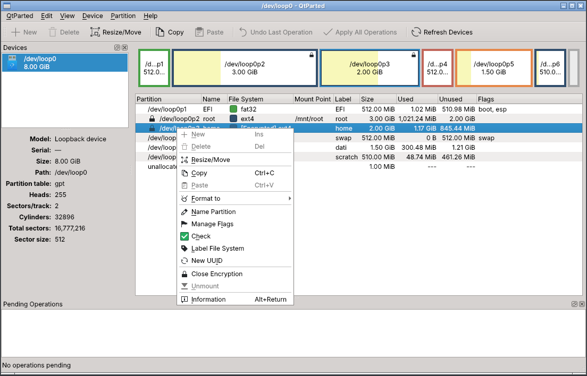
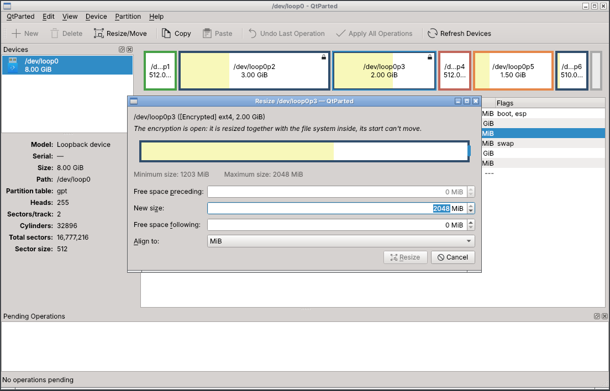
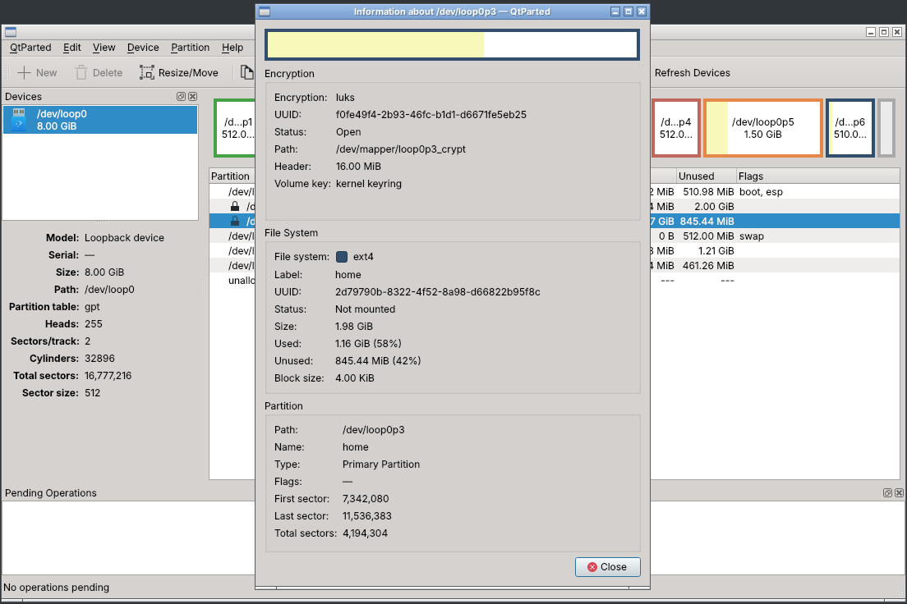

# QtParted

**A partition editor for Qt 6. It plans every change on screen first and writes
nothing to disk until you apply it.**

[](https://github.com/zanac/qtparted/actions/workflows/ci.yml)


QtParted creates, deletes, resizes, moves, copies, checks and formats disk
partitions. It also opens and resizes LUKS encrypted volumes, mounts file
systems, and turns swap and LVM Volume Groups on and off. It is built on
[libparted](https://www.gnu.org/software/parted/) and the file system tools
already installed on your system. It is a small Qt Widgets application that does
not need KDE Frameworks, so it fits desktops as well as live and rescue systems.


QtParted started in 2002 as a Qt 3 "Partition Magic" style frontend to
libparted. Version 1.0 is a complete rewrite for Qt 6. Its core is modelled on
[GParted](https://gparted.org) 1.8: the same operation model, the same file
system rules and the same safety checks. The aim is to match GParted feature for
feature, in a native Qt application.

---

## Contents

- [Plan first, apply once](#plan-first-apply-once)
- [Resize, move, copy](#resize-move-copy)
- [Encrypted partitions (LUKS)](#encrypted-partitions-luks)
- [Mount, swap and LVM](#mount-swap-and-lvm)
- [Built not to lose your data](#built-not-to-lose-your-data)
- [Supported file systems](#supported-file-systems)
- [Install and build](#install-and-build)
- [Running](#running)
- [Tests](#tests)
- [Project status](#project-status)
- [Source layout](#source-layout)
- [License and credits](#license-and-credits)

---

## Plan first, apply once

Every change goes into a list of **pending operations**. The disk map and the
partition list show the disk as it will look once those operations are applied.
Until then nothing is written to the disk, and you can undo the last step or
clear the whole list. Consecutive changes to the same partition are merged: two
resizes in a row become a single resize.

 

- **Partition tables**: gpt, msdos and every other libparted table type.
- **New partitions**: primary, extended and logical, aligned to MiB, to
  cylinders, or to the exact sector. Size them with a graphical resizer or by
  typing values. You can also set the partition name (GPT), the file system and
  its label.
- **Format** to any supported file system, or clear the old signatures only.
- **Delete** partitions. Logical partitions are renumbered as the kernel will
  number them, and a deletion is refused if a logical partition with a higher
  number is in use.
- **Flags** (boot, esp, lvm, …) and **GPT partition names**, queued like every
  other change.
- **Check and repair** a file system, set its **label**, give it a **new UUID**.

When you apply, a dialog shows each operation as it runs, broken down into its
steps. Every external command is listed with its live output. You can stop after
the current operation and save the whole log as HTML.


## Resize, move, copy

 

- **Resize and move** primary, logical and extended partitions. Drag either edge
  or the whole partition, or type the space before, the size and the space after.
  The used space is drawn in the dialog, and the limits come from the file system
  (its minimum and maximum size, and whether it can shrink at all).
- Each file system is resized with its own tools: `resize2fs`, `ntfsresize`,
  `btrfs filesystem resize`, `xfs_growfs`, … FAT and HFS are resized with
  libparted. Swap is recreated and keeps its label and UUID.
- **Moves** use an internal block copy that handles overlapping source and
  destination ranges, so a partition can move into its own space. If the copy
  fails part way, the blocks already copied are copied back, as GParted does.
  NTFS boot sectors are updated for the new position.
- **Online resize**: file systems that support it can be grown, and some shrunk,
  while they are mounted. The start of a mounted partition can't move.
- **Copy and paste** a partition into free space, either at the same size or
  larger (the file system is then grown to fill it), or over an existing
  partition.

## Encrypted partitions (LUKS)

 

- **Open and close** LUKS encryption from the partition menu. The passphrase
  goes to `cryptsetup` on its standard input. It is kept in locked memory
  (`mlock`) only for as long as QtParted runs, and is wiped when QtParted exits.
- An open LUKS partition shows the file system inside it, for example
  "[Encrypted] ext4", with that file system's label, usage and mount points. You
  can then **resize** it (encryption and file system together), and **check**,
  **label**, **change the UUID** of or **format** the file system inside it. You
  can also **copy** its decrypted contents to a new partition.
- A closed LUKS partition can be moved or grown. The encrypted area grows to fill
  the partition the next time it is opened.
- When the volume key is kept in the kernel keyring (the default for LUKS2), a
  resize needs the passphrase. QtParted asks for it and tests it before queuing
  the operation.

## Mount, swap and LVM

These actions run immediately, as in GParted, and the device list is refreshed
afterwards. Each one is refused while operations are pending for that
partition.

- **Mount on** any mount point listed for the file system in `/etc/fstab`, and
  **Unmount** from all its mount points. A mount point that has another file
  system mounted on top of it is left alone.
- **Swapon / Swapoff**.
- **Activate / Deactivate** the LVM Volume Group of a Physical Volume. Deleting,
  formatting or pasting over a Physical Volume that belongs to a Volume Group
  needs explicit confirmation.

## Built not to lose your data

Most of QtParted's code is about **not** doing the wrong thing:

- Partitions that are mounted, active as swap, held by device-mapper, LVM or
  MD, or open as LUKS, can't be changed. Only the actions that are safe while
  they are in use (unmount, close, online resize, online label) are offered.
- Right before each operation runs, QtParted checks the target again. The
  partition must still be in the partition table with the same geometry, the
  kernel must see it at the same position, and it must be exactly as busy as when
  the operation was queued. For example, an online resize is refused if the file
  system was unmounted in the meantime, so its tools can't act on whatever is
  mounted there now. A paste onto the source's own sectors is refused too.
- Every partition table change is committed and checked against what libparted
  actually wrote.
- The end-to-end tests compare checksums of the data in the file system before
  and after every resize, move and copy.

## Supported file systems

What QtParted can do with each file system when its tools are installed. The
**File System Support** dialog (View menu) shows what is available on your
system and which packages provide the missing tools.

| File system | Create | Grow | Shrink | Move | Copy | Check | Label | UUID | Package |
|---|:-:|:-:|:-:|:-:|:-:|:-:|:-:|:-:|---|
| bcachefs | ✓ | ✓ online too | — | ✓ | ✓ | ✓ | — | — | bcachefs-tools |
| btrfs | ✓ | ✓ online too | ✓ online too | ✓ | ✓ | ✓ | ✓ online too | ✓ | btrfs-progs |
| exfat | ✓ | — | — | ✓ | ✓ | ✓ | ✓ | ✓ | exfatprogs |
| ext2 | ✓ | ✓ | ✓ | ✓ | ✓ | ✓ | ✓ online too | ✓ | e2fsprogs |
| ext3 / ext4 | ✓ | ✓ online too | ✓ | ✓ | ✓ | ✓ | ✓ online too | ✓ | e2fsprogs |
| f2fs | ✓ | ✓ | — | ✓ | ✓ | ✓ | — | — | f2fs-tools |
| fat16 / fat32 | ✓ | ✓ | ✓ | ✓ | ✓ | ✓ | ✓ | ✓ | dosfstools, mtools |
| hfs / hfs+ | ✓ | — | ✓ | ✓ | ✓ | ✓ | — | — | hfsutils / hfsprogs |
| jfs | ✓ | ✓ online too | — | ✓ | ✓ | ✓ | ✓ | ✓ | jfsutils |
| linux-swap | ✓ | ✓ | ✓ | ✓ | ✓ | — | ✓ | ✓ | util-linux |
| LUKS | — | ✓ online too | online only | ✓ | contents only | — | — | — | cryptsetup |
| LVM2 PV | ✓ | ✓ online too | ✓ online too | ✓ | — | ✓ | — | — | lvm2 |
| minix | ✓ | — | — | ✓ | ✓ | ✓ | — | — | util-linux |
| nilfs2 | ✓ | ✓ online too | ✓ online too | ✓ | ✓ | — | ✓ | ✓ | nilfs-utils |
| ntfs | ✓ | ✓ | ✓ | ✓ | ✓ | ✓ | ✓ | ✓ | ntfs-3g |
| reiser4 | ✓ | — | — | ✓ | ✓ | ✓ | — | — | reiser4progs |
| reiserfs | ✓ | ✓ online too | ✓ | ✓ | ✓ | ✓ | ✓ | ✓ | reiserfsprogs |
| udf | ✓ | — | — | ✓ | ✓ | — | ✓ | ✓ | udftools |
| xfs | ✓ | ✓ online too | — | ✓ | ✓ | ✓ | ✓ | ✓ | xfsprogs |

"Online" means the action also works while the file system is mounted (or,
for LUKS, while the encryption is open). Many more file systems and partition
contents are recognised and shown, but not changed: BitLocker, APFS, ZFS,
ISO 9660, RAID members, bcache and others.


## Install and build

QtParted 1.0 is not released yet. Build it from the
[`qt6`](https://github.com/zanac/qtparted/tree/qt6) branch.

Requirements:

- CMake ≥ 3.19 and a C++20 compiler (GCC 11+, Clang 14+)
- Qt ≥ 6.4: Core, Gui, Widgets (and Test for the tests)
- libparted ≥ 3.1 with libparted-fs-resize, and libblkid (util-linux), with
  their development files
- pkg-config

Debian / Ubuntu:

```sh
sudo apt install cmake ninja-build g++ pkg-config qt6-base-dev libparted-dev libblkid-dev
```

Fedora:

```sh
sudo dnf install cmake ninja-build gcc-c++ qt6-qtbase-devel parted-devel libblkid-devel
```

Then:

```sh
git clone -b qt6 https://github.com/zanac/qtparted.git
cd qtparted
cmake -S . -B build -G Ninja -DCMAKE_BUILD_TYPE=Release -DCMAKE_INSTALL_PREFIX=/usr
cmake --build build
ctest --test-dir build --output-on-failure      # optional, see Tests
sudo cmake --install build
```

Options: `-DQTPARTED_BUILD_GUI=OFF` builds only the core library and its tests;
`-DQTPARTED_BUILD_TESTS=OFF` skips the tests.

At runtime QtParted needs:

- `pkexec` (polkit), used by the `qtparted` launcher;
- the Qt SVG icon engine (`qt6-svg` / `libqt6svg6`), which draws the Breeze
  icons;
- the tools of the file systems you use (see the table above), plus `cryptsetup`
  and `dmsetup` for LUKS and `lvm2` for Volume Groups.

## Running

```sh
qtparted                 # all disks; asks for the administrator password
qtparted /dev/sdb        # only this device
qtparted disk.img        # a disk image file
```

The installed `qtparted` command is a launcher that runs the program
(`libexec/qtparted/qtparted`) as root through pkexec, as GParted does. It passes
the graphical session through:

- X11 and XWayland get a temporary `xhost +SI:localuser:root` grant;
- Wayland gets its display socket and a short whitelist of desktop settings
  (theme, scaling, cursor).

On disk image files the partition table can be edited directly. File systems
need a block device, so attach the image first:
`sudo losetup -P --show -f disk.img`.

## Tests

| Test | What it covers | Needs |
|---|---|---|
| `tst_model` | Partition model, alignment, limits, the operation queue, merging and the allowed-action rules. Touches no device. | — |
| `tst_disk` | Partition tables, create, format and delete, on image files and loop devices. | root for loop devices |
| `tst_f2` | Resize, move (both directions, overlapping, logical and extended), copy and paste, check, label, UUID and online grow. Data checksums are compared after every step. | root |
| `tst_f3` | LUKS open, close, resize, check, label, UUID, format and copy; mount, unmount (including stacked mounts) and swapon/swapoff. | root, cryptsetup |

Tests that need root are skipped without it. Many containers have no
device-mapper in their kernel, so `tst_f3` then puts `tests/fakecrypt`, a small
test double for `cryptsetup` and `dmsetup`, first in `PATH`. It "opens" a real
LUKS volume as a loop device starting at the data offset, so the real file
system tools work inside it. The LUKS headers and passphrases stay real.

## Project status

| Phase | Content | Status |
|-------|---------|--------|
| F0 | Qt 6 skeleton, read-only scanning, main window, device information | done |
| F1 | Partition tables, new / delete / format, flags, names, alignment, operation queue, details log | done |
| F2 | Resize / move with the file system tools, copy & paste, check, file system label, new UUID | done |
| F3 | LUKS open/close and resize, LVM Volume Group activation, swapon/swapoff, mount/unmount | done |
| F4 | Translations, manual, packaging polish | planned |

Bug reports and ideas are welcome in the
[issue tracker](https://github.com/zanac/qtparted/issues).

## Source layout

```
src/core/       GUI-independent library (QtCore + libparted + libblkid)
  Parted          libparted backend: scanning, partition table changes, block copy
  Probe           libblkid probing, also at an offset inside image files
  SystemInfo      mounts, swaps, sysfs holders, fstab, /proc/partitions
  FileSystem      file system definitions: tools, limits, mkfs, usage, capabilities
  FsMaintenance   resize, check, label and UUID commands of each file system
  Luks            open LUKS mappings, open/close/resize, passphrase store
  BusyActions     mount, unmount, swapon/swapoff, Volume Group activation
  Operation       pending operations: visual preview, merging, execution
  Steps           resize/move/copy/check sequences used by the operations
  Session         devices + operation queue + allowed actions
  Layout          geometry, alignment and limits for the partition dialogs
  Worker          device scanning and the operation applier thread
src/app/        Qt Widgets user interface
data/           launcher, polkit policy, desktop file, AppStream metainfo, icons
tests/          unit and end-to-end tests, fakecrypt test double
doc/            man page and screenshots
```

## License and credits

QtParted is free software, released under the GNU General Public License
version 2 or (at your option) any later version. See [COPYING](COPYING).

Copyright © 2002–2026 Vanni Brutto.

Much of the partition handling logic is derived from **GParted**, © Bart
Hakvoort, Curtis Gedak, Mike Fleetwood and the GParted contributors,
GPL-2.0-or-later. This includes the device scanning, the operation model, the
alignment rules, the file system commands and limits, the resize/move/copy
sequences and the LUKS support. The source files that contain derived code say
so in their headers.
