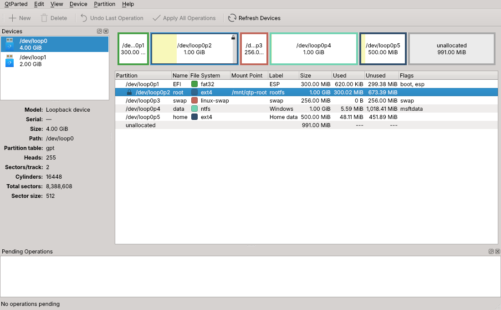

# QtParted

QtParted is a graphical partition editor for Qt 6, built on
[libparted](https://www.gnu.org/software/parted/). It shows the partitions of
every disk, lets you queue changes and applies them all at once, logging every
step in detail.

QtParted started in 2002 as a Qt 3 "Partition Magic" style frontend to libparted.
Version 1.0 is a rewrite for Qt 6. Its new core follows the design of
[GParted](https://gparted.org): a pending-operation model, one class per file
system, and tool detection. Its aim is to close the feature gap with GParted
while remaining a lightweight Qt application with no KDE Frameworks dependency,
so it also fits live and rescue systems.



## Features (1.0 development version)

- Scan all disks (SATA/SCSI, NVMe, MMC, MD RAID, NBD and attached loop devices),
  or only the devices and disk image files given on the command line.
- Graphical disk map and partition tree, with logical partitions inside the
  extended one, used/unused space, mount points, labels, UUIDs, flags and GPT
  partition names.
- Pending operations, with undo and clear, that are shown on the disk before
  anything is written:
  - create a partition table (gpt, msdos and every other libparted label type);
  - create primary, extended and logical partitions, aligned to MiB, to
    cylinders or not at all, sized with a graphical resizer;
  - delete partitions (logical partitions are renumbered as the kernel will do);
  - format to any supported file system, or clear the old signatures;
  - set partition flags (queued, unlike in GParted);
  - set GPT partition names;
  - resize and move partitions, including logical and extended ones, with the
    file system's own tools (or libparted for FAT and HFS); moves use an
    internal block copy that is rolled back if it fails; mounted file systems
    that support it can be grown (and some shrunk) online;
  - copy a partition and paste it into free space, optionally larger, or over
    another partition;
  - check and repair a file system, set its label, give it a new UUID.
- 21 file systems for creation and usage reporting: bcachefs, btrfs, exfat,
  ext2/3/4, f2fs, fat16/32, hfs, hfs+, jfs, linux-swap, LVM2 PV, minix, nilfs2,
  ntfs, reiser4, reiserfs, udf, xfs. Many more are recognised (LUKS, BitLocker,
  APFS, ZFS, RAID members...).
- Detection of mounted file systems, active swap and devices held by
  device-mapper, LVM or MD, so those partitions can't be modified.
- A "File System Support" dialog shows, for every file system, which actions
  (create, grow, shrink, move, copy, check, label, UUID, usage) are available,
  which tools are installed and which packages provide the missing ones.
- An apply dialog shows live, expandable details of every command and its output,
  can stop after the current operation, and saves an HTML log.

### Roadmap

| Phase | Content | Status |
|-------|---------|--------|
| F0 | Qt 6 skeleton, read-only scanning, main window, device information | done |
| F1 | Partition table, new / delete / format, flags, names, alignment, operation queue, details log | done |
| F2 | Resize / move with the file system tools, copy & paste, check, file system label, new UUID | done |
| F3 | LUKS open/close and resize, LVM PV activation, swapon/swapoff, mount/unmount | planned |
| F4 | Translations, manual, packaging polish | planned |

## Building

Requirements:

- CMake >= 3.19 and a C++20 compiler (GCC 11+, Clang 14+)
- Qt >= 6.4: Core, Gui, Widgets (and Test for the tests)
- libparted >= 3.1 and libblkid (util-linux), with their development files
- pkg-config

On Debian/Ubuntu:

```sh
sudo apt install cmake ninja-build g++ pkg-config qt6-base-dev libparted-dev libblkid-dev
```

On Fedora:

```sh
sudo dnf install cmake ninja-build gcc-c++ qt6-qtbase-devel parted-devel libblkid-devel
```

Then:

```sh
cmake -S . -B build -G Ninja -DCMAKE_BUILD_TYPE=Release -DCMAKE_INSTALL_PREFIX=/usr
cmake --build build
ctest --test-dir build --output-on-failure      # optional
sudo cmake --install build
```

Options: `-DQTPARTED_BUILD_GUI=OFF` builds only the core library and its tests,
and `-DQTPARTED_BUILD_TESTS=OFF` skips the tests.

### Runtime

- `pkexec` (polkit) for the `qtparted` launcher
- the Qt SVG icon engine (`qt6-svg` / `libqt6svg6`), so the Breeze theme icons
  are drawn
- the file system tools you need, e.g. `e2fsprogs`, `dosfstools`, `mtools`,
  `ntfs-3g`, `btrfs-progs`, `xfsprogs`, `exfatprogs`, `f2fs-tools`

## Running

```sh
qtparted                 # all disks, asks for the administrator password
qtparted /dev/sdb        # only one device
qtparted disk.img        # a disk image file
```

The installed `qtparted` command is a launcher that runs the program
(`libexec/qtparted/qtparted`) as root through pkexec, like GParted does. It
passes the graphical session through: X11 and XWayland get a temporary
`xhost +SI:localuser:root` grant, and Wayland gets its display socket and a
short whitelist of desktop settings.

On disk image files, the partition table can be edited directly. File systems
need a block device, so attach the image first: `sudo losetup -P --show -f disk.img`.

## Tests

`tests/tst_model` covers the partition model, alignment, the operation queue and
merging, without touching any device. `tests/tst_disk` works on image files and,
when it runs as root, on temporary loop devices. It creates msdos and GPT tables,
primary, extended and logical partitions, and ext4, fat32, swap, ntfs and f2fs
file systems, then formats and deletes them, checking the result after each
step. Loop tests are skipped without root.

## Source layout

```
src/core/   GUI-independent library (QtCore + libparted + libblkid)
  Parted        libparted backend: scanning and partition table changes
  Probe         libblkid probing, also at an offset for image files
  SystemInfo    mounts, swaps, sysfs holders, fstab, /proc/partitions
  FileSystem    file system definitions: tools, limits, mkfs, usage
  Operation     pending operations, visual re-application, merging
  Session       devices + operation queue + allowed actions
  Layout        geometry and alignment of new partitions
  Worker        device scanning and the operation applier thread
src/app/    Qt Widgets user interface
data/       launcher, polkit policy, desktop file, AppStream metainfo, icons
tests/      unit and end-to-end tests
```

## License

QtParted is free software, released under the GNU General Public License
version 2 or (at your option) any later version. See [COPYING](COPYING).

Copyright © 2002–2026 Vanni Brutto.

Much of the partition handling logic (device scanning, the operation model,
alignment rules, file system commands and limits) is derived from GParted,
© Bart Hakvoort, Curtis Gedak, Mike Fleetwood and the GParted contributors,
GPL-2.0-or-later. The source files that contain derived code say so in their
headers.
