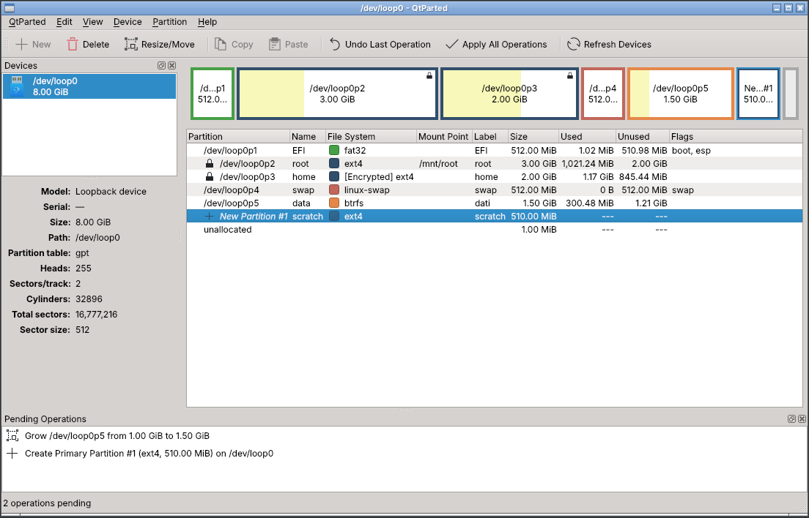
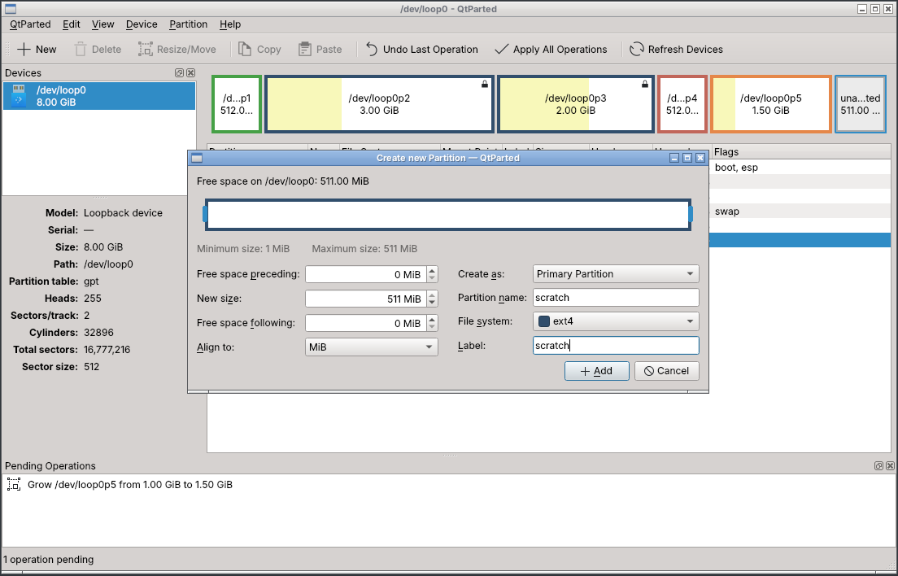
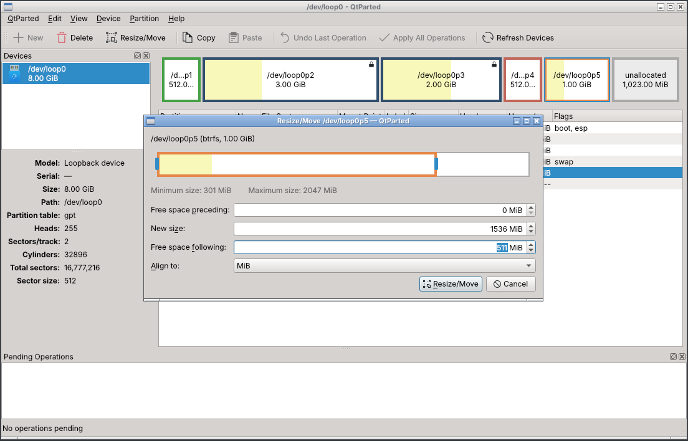
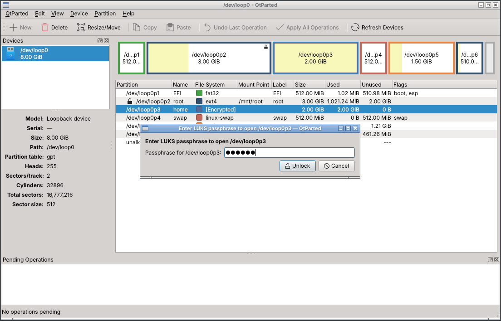
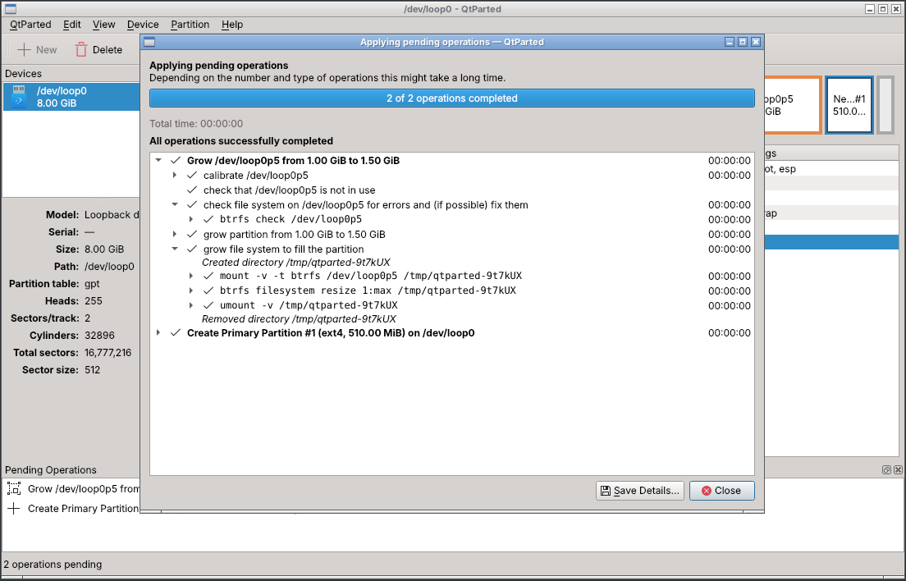
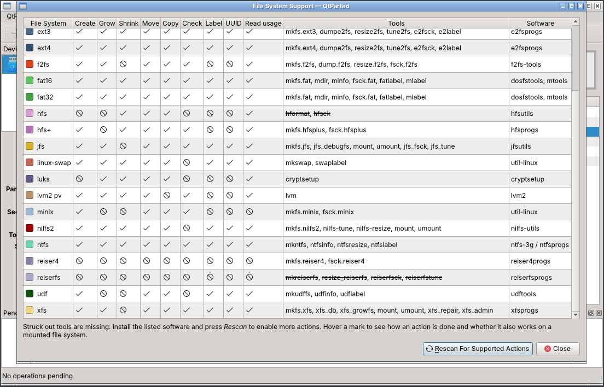

# QtParted Manual

QtParted is a partition editor: it creates, deletes, resizes, moves, copies,
checks and formats the partitions of your disks. This manual explains how to use
it safely.

**Before changing partitions, back up your data.** QtParted checks everything it
can, but a power cut, a failing disk or a wrong choice can still destroy data.

## Contents

1. [Starting QtParted](#starting-qtparted)
2. [The main window](#the-main-window)
3. [How changes are made: pending operations](#how-changes-are-made-pending-operations)
4. [Partition tables](#partition-tables)
5. [Creating partitions](#creating-partitions)
6. [Deleting and formatting](#deleting-and-formatting)
7. [Resizing and moving](#resizing-and-moving)
8. [Copying and pasting](#copying-and-pasting)
9. [Check, label and UUID](#check-label-and-uuid)
10. [Flags and partition names](#flags-and-partition-names)
11. [Encrypted partitions (LUKS)](#encrypted-partitions-luks)
12. [Mount, unmount, swap and LVM](#mount-unmount-swap-and-lvm)
13. [Applying the operations](#applying-the-operations)
14. [File system support](#file-system-support)
15. [Troubleshooting](#troubleshooting)
16. [Keyboard shortcuts](#keyboard-shortcuts)

## Starting QtParted

Start QtParted from the application menu (System → QtParted) or with the
`qtparted` command. It needs administrator rights to read and change disks, so
your system asks for the administrator password (through polkit).

```sh
qtparted                 # all disks
qtparted /dev/sdb        # only the disk /dev/sdb
qtparted disk.img        # a disk image file
```

At start QtParted scans every disk. **Refresh Devices** (Ctrl+R) scans them again,
for example after you plug in a USB stick.

## The main window



- **Devices** (left): the disks that were found. Select one to show its
  partitions. Below the list are the details of the selected disk: model, serial
  number, size, partition table type and geometry.
- **Disk map** (top): every partition drawn to scale. The coloured frame is the
  file system type, the yellow area is the used space. A lock marks a partition
  that is in use (mounted, active swap, open encryption).
- **Partition list** (centre): the same partitions with their name, file system,
  mount point, label, size, used and unused space, and flags. Logical partitions
  are shown inside the extended partition.
- **Pending Operations** (bottom): the changes waiting to be applied.

Click a partition in the map or in the list to select it. Right-click it for the
partition menu, double-click it for its information.

## How changes are made: pending operations

QtParted never changes a disk while you are working. Every action (create,
delete, resize, …) is added to the **Pending Operations** list, and the disk map
and partition list show the disk **as it will be** after those operations. You
can keep planning, look at the result and change your mind:

- **Edit → Undo Last Operation** (Ctrl+Z) removes the last operation;
- **Edit → Clear All Operations** removes them all;
- **Edit → Apply All Operations** (Ctrl+Enter) writes them to the disk, in order.

Changes to the same partition are combined: resizing a partition twice gives a
single resize, and the settings of a partition that is still to be created are
folded into its creation.

Partitions that are in use can't be changed (only actions that are safe on a
mounted file system are offered). Unmount them first, or start QtParted from a
live system to change the partitions of the running system.

## Partition tables

**Device → Create Partition Table** replaces the partition table of the selected
disk with a new, empty one. **This erases everything on the disk.** Choose:

- **gpt** for UEFI computers and for disks larger than 2 TiB (up to 128
  partitions);
- **msdos** (MBR) for old BIOS computers (up to 4 primary partitions, or 3 and an
  extended partition containing logical partitions).

Other table types supported by libparted (for example `loop`, `sun`, `mac`) are
listed too.

## Creating partitions

Select an unallocated space and choose **Partition → New** (Insert).



- Drag the edges of the partition in the bar at the top, or type the **free space
  preceding**, the **new size** and the **free space following**, in MiB.
- **Align to**: *MiB* (recommended: the start of the partition falls on a 1 MiB
  boundary, which is right for SSDs and modern disks), *Cylinder* (for very old
  operating systems) or *None* (exact sectors).
- **Create as**: primary, extended or logical (msdos tables only). Logical
  partitions go inside the extended partition.
- **Partition name** (gpt only), **File system** and **Label**. Choose *cleared*
  to erase old signatures without creating a file system, or *unformatted* to
  create the partition only.

File systems whose tools are missing are greyed out; their tooltip says what to
install.

## Deleting and formatting

- **Partition → Delete** (Delete key) removes the partition. An extended partition
  can be deleted only when it is empty. When a logical partition is deleted, the
  following logical partitions are renumbered (sdb6 becomes sdb5), as the kernel
  will do: QtParted refuses if one of them is in use.
- **Partition → Format to** creates a new, empty file system in the partition.
  Everything in it is lost. *cleared* only erases the old file system signatures.

## Resizing and moving

Select a partition and choose **Partition → Resize/Move**.



Drag the edges to resize, drag the middle to move, or type the values. The
yellow area is the space used by the file system: the partition can't be shrunk
below it. The minimum and maximum sizes come from the file system: some can't
shrink (xfs, f2fs, jfs), some can't grow, some can't be resized at all; the
**File System Support** dialog lists them.

- The file system is resized with its own tool (`resize2fs`, `ntfsresize`,
  `btrfs`, …) or with libparted (FAT, HFS). It is checked first.
- A move copies the whole file system block by block. This can take a long time
  on large partitions. If the copy fails, the blocks already moved are copied
  back.
- **Moving the start of a partition can stop your computer from booting** if the
  partition holds the operating system, the boot loader or its files. QtParted
  warns you. Repair the boot loader afterwards if needed (for GRUB, reinstall it
  from a live system).
- A **mounted** file system can be resized while in use (*online*) when the file
  system supports it, for example growing ext4, btrfs or xfs. Its start can't
  move.
- An **extended** partition can be resized around its logical partitions.

## Copying and pasting

Select a partition, choose **Partition → Copy** (Ctrl+C), then select where to
put it and choose **Partition → Paste** (Ctrl+V):

- on **unallocated space**: a dialog lets you choose the position and the size of
  the new partition; when it is larger than the original, the file system is
  grown to fill it;
- on an **existing partition**: its content is replaced by the copy (you are
  warned).

The copy is exact, block by block, so it has the same UUID and label as the
original. Use **New UUID** on the copy if both will be used on the same
computer.

## Check, label and UUID

- **Partition → Check** checks the file system for errors, repairs what can be
  repaired, and then grows it to fill the partition.
- **Partition → Label File System** sets the label (the name shown by file
  managers). Some file systems allow this while mounted.
- **Partition → New UUID** gives the file system a new random UUID. Update
  `/etc/fstab` and the boot loader if they refer to the old one.

## Flags and partition names

- **Partition → Manage Flags** sets the flags of the partition: *boot* / *esp*
  for the EFI System Partition, *bios_grub*, *lvm*, *raid*, *hidden*, … Each flag
  has a short explanation.
- **Partition → Name Partition** sets the partition name (gpt and a few other
  table types), not to be confused with the file system label.

Both are queued like the other operations.

## Encrypted partitions (LUKS)

A LUKS partition is shown as **[Encrypted]**. While it is closed QtParted can
only move it, grow it, format it (which removes the encryption) or delete it.

**Partition → Open Encryption** asks for the passphrase and opens it.



Once it is open, the partition shows the file system inside it, for example
**[Encrypted] ext4**, and you can:

- **resize** it: the file system and the encryption are resized together;
- **check**, **label**, give a **new UUID** to or **format** the file system
  inside, without touching the encryption;
- **copy** its decrypted content and paste it over another partition (QtParted
  warns that the copy is not encrypted).

**Partition → Close Encryption** closes it again (unmount the file system inside
first). The passphrase is kept in protected memory while QtParted runs, so it is
not asked again, and it is wiped when QtParted exits. With LUKS2 the passphrase is
also needed to resize an open volume: QtParted asks for it before queuing the
resize.

## Mount, unmount, swap and LVM

These actions are applied immediately (they are not pending operations), and the
disks are scanned again afterwards. They are refused while operations are
pending for the partition: apply or undo them first.

- **Mount on**: mounts the file system on one of the mount points that
  `/etc/fstab` lists for it.
- **Unmount**: unmounts it from all its mount points. If another file system is
  mounted on top of the same directory, unmount that one yourself first.
- **Swapon / Swapoff**: activates or deactivates a swap partition.
- **Activate / Deactivate**: the LVM Volume Group of a Physical Volume (shown in
  the Mount Point column). While the Volume Group is active, its Physical
  Volumes are in use.

Deleting, formatting or pasting over a Physical Volume that belongs to a Volume
Group damages the Volume Group: QtParted asks for confirmation.

## Applying the operations

**Edit → Apply All Operations** asks for confirmation, then runs the operations
one after the other.



Each operation shows its steps. Expand them to see every command that runs and
its output. **Stop After Current Operation** stops at the end of the operation in
progress (an operation is never interrupted half way). If an operation fails,
the following ones are not run. **Save Details** saves the whole log as an HTML
file, useful for a bug report.

Before each operation QtParted checks again that the partition is where it
expects it and that it is not in use. If something changed in the meantime (a
file system was mounted or unmounted, the partition table was changed by another
program), the operation is refused and nothing is written.

When all operations are done, the disks are scanned again.

## File system support

**View → File System Support** lists, for every file system, which actions are
available on this system, the tools QtParted uses and the package that provides
them. Missing tools are struck out: install the package and press **Rescan For
Supported Actions**.



## Troubleshooting

**"QtParted is not running with root privileges"**
: start it with the `qtparted` command or from the menu, which ask for the
  administrator password, not by running the program in `libexec` directly.

**A partition can't be changed**
: it is in use: unmount it, turn its swap off, close its encryption or deactivate
  its Volume Group. The root file system of the running system can only be grown
  online; for anything else start QtParted from a live system.

**"The kernel sees … at a different position"**
: another program changed the partition table, or the kernel could not be told
  about a change. Refresh the devices; if the message stays, reboot.

**A disk image file**
: its partition table can be edited directly, but file systems need a block
  device. Attach it with `sudo losetup -P --show -f disk.img` and open the loop
  device.

**The computer doesn't boot after a move**
: the boot loader refers to the old position. Boot a live system and reinstall or
  repair the boot loader (for GRUB: `grub-install` and `update-grub` from a
  chroot).

**An operation failed**
: expand its details in the apply dialog to see the failing command and its
  output, and save the details. Please report bugs at
  <https://github.com/zanac/qtparted/issues>, attaching the saved details.

## Keyboard shortcuts

| Key | Action |
|---|---|
| Insert | New partition |
| Delete | Delete partition |
| Ctrl+C / Ctrl+V | Copy / paste partition |
| Alt+Enter | Partition information |
| Ctrl+Z | Undo last operation |
| Ctrl+Enter | Apply all operations |
| Ctrl+R | Refresh devices |
| F1 | This manual |
| Ctrl+Q | Quit |
